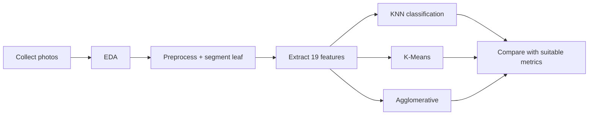

<div align="center">
# 🍃 Leaf Classification & Clustering
 
**KNN · K-Means · Agglomerative Clustering on a self-collected leaf image dataset**
 
[](https://huggingface.co/datasets/illeven0h/leaf-classification-dataset)
[](https://github.com/illeven0h/leaf-classification-knn-clustering/blob/main/Leaf_Classification_Notebook.ipynb)


 
</div>
---
 
## 📌 Overview
 
An end-to-end machine learning project built for the **Advanced Artificial Intelligence** course. I photographed leaves of three houseplants in my own garden, turned the images into numerical features, and used them to compare **one supervised** and **two unsupervised** algorithms:
 
| Task | Algorithm |
|---|---|
| Supervised classification | **K-Nearest Neighbors (KNN)** |
| Unsupervised clustering | **K-Means** |
| Unsupervised clustering | **Agglomerative (hierarchical) clustering** |
 
The central question: *can simple hand-crafted colour, texture and shape features tell the three plants apart, and can an algorithm discover those groups without ever seeing the labels?*
 
## 🗂️ Dataset
 
**👉 [Leaf Classification Dataset on Hugging Face](https://huggingface.co/datasets/illeven0h/leaf-classification-dataset)**
 
All images are original photos taken with a **Samsung Galaxy A54** in a home garden. No internet images were used.
 
| Class | Plant | Distinguishing look | Images |
|---|---|---|---|
| `spider` | Spider plant | long, thin, strap-like leaves | 35 |
| `money` | Money plant | heart-shaped, glossy, often yellow-green patches | 35 |
| `arrowhead` | Arrowhead plant | arrow-shaped leaves with visible veins | 35 |
| | | **Total** | **105** |
 
**Collection procedure.** Every photo shows a *different* leaf (young and mature, from different stems). Conditions were deliberately varied and balanced across classes:
 
- 💡 **Lighting:** direct sun · shade · indoor/evening
- 🧱 **Background:** white paper · ground · hand · wall
- 📏 **Distance:** close (~15 cm) · medium (~30 cm) · far (~60 cm)
- 🔄 **Orientation:** flat · tilted · rotated
Each photo was logged immediately in an image log sheet (lighting, background, distance, orientation, notes). No filters, beauty mode or zoom were used, and EXIF metadata (including GPS location) was removed before publishing.
 
## 🔬 How I did it
 

 
### 1. Exploratory data analysis
Dataset structure, missing values, duplicate detection (file hashing), outliers (IQR rule), distributions, correlations, class balance, sample grids, plus image-specific checks: sizes, colour histograms, brightness, contrast and sharpness (variance of the Laplacian).
 
### 2. Preprocessing
EXIF orientation fix → resize with letterboxing (shape is never distorted) → duplicate removal → **leaf segmentation** with the Excess-Green index + Otsu threshold + morphology, so features describe the *leaf*, not the background → feature scaling.
 
### 3. Feature engineering (19 features, 17 after removing near-duplicates)
 
| Group | Features |
|---|---|
| **Colour** (leaf pixels only) | mean R/G/B, mean H/S/V, brightness spread, green ratio |
| **Texture** | edge density (Canny), LBP entropy, LBP non-uniform ratio |
| **Gradient** | HOG mean and standard deviation |
| **Shape** | area ratio, elongation, solidity, eccentricity, extent, circularity |
 
Feature pruning uses only feature–feature correlation (|r| > 0.95), so no labels leak into the clustering experiments.
 
## 🤖 Algorithms
 
### K-Nearest Neighbors (supervised)
Classifies a leaf by majority vote of its K closest training leaves.
- **Tuned:** K ∈ {1, 3, 5, 7, 9} × distance ∈ {Euclidean, Manhattan}
- **Protocol:** stratified 75/25 split; `StandardScaler` inside a `Pipeline` (no leakage); configuration chosen by 5-fold CV on the training set only; test set used once; repeated 5×10 CV reported as a more stable estimate
- **Metrics:** accuracy, precision, recall, F1, confusion matrix, error analysis with the misclassified images
### K-Means (unsupervised)
Alternates between assigning leaves to the nearest centroid and moving centroids to cluster means, minimising within-cluster sum of squares.
- **Tuned:** K = 2…8, `n_init=10`
- **Evaluated with:** elbow method (WCSS), Silhouette Score, PCA visualisation, cluster profiles, dominant class per cluster, ARI and NMI
### Agglomerative clustering (unsupervised)
Starts with every leaf as its own cluster and repeatedly merges the closest pair.
- **Tuned:** linkage ∈ {single, complete, average, Ward} × clusters ∈ {2, 3, 4, 5}
- **Evaluated with:** Silhouette, ARI, NMI, cophenetic correlation, dendrogram (leaves coloured by true class), merge-history analysis
### Comparing apples with apples
Clustering and classification are **not** compared by accuracy. KNN is judged on held-out labelled data; the clustering methods are judged by the **Silhouette Score** (internal) and **ARI / NMI** (agreement with true classes, independent of arbitrary cluster numbers).
 
## 📁 Repository structure
 
```
├── Leaf_Assignment_Notebook.ipynb   # full pipeline: EDA → features → KNN → K-Means → Agglomerative → comparison
├── leaf_features.csv                # extracted feature table
├── leaf_image_metadata.csv          # per-image statistics
└── README.md
```
The images themselves live on [Hugging Face](https://huggingface.co/datasets/illeven0h/leaf-classification-dataset).
 
## ▶️ Run it yourself
 
1. Click the **Open in Colab** badge above.
2. Put the dataset where the notebook expects it (the folder with `spider/`, `money/`, `arrowhead/`), or download it from the Hugging Face page.
3. Run all cells from top to bottom. Everything is seeded (`SEED = 42`), so results are reproducible.
**Requirements:** `numpy` `pandas` `matplotlib` `seaborn` `pillow` `scipy` `scikit-learn` `scikit-image` `openpyxl` (all pre-installed in Colab).
 
## ⚠️ Limitations
 
- Small dataset (105 images): test accuracy is noisy, and one extra mistake moves it by several points.
- Leaves come from a few plants in a single garden, so variation is lower than in real-world data.
- Greenness-based segmentation can fail on yellow or white leaf patches and on green backgrounds.
- Lighting and background shift the colour features, so clustering may group by photo conditions rather than plant type.
- Hand-crafted features discard information; learned features (e.g. CNN embeddings) would likely do better.
## 🔭 Future work
More plants and photographers, controlled lighting, a deep-learning feature extractor, and a proper held-out test set from a different day or garden.
 
## 📜 License
Dataset: [CC BY 4.0](https://creativecommons.org/licenses/by/4.0/). Code: MIT (add a `LICENSE` file if you want it explicit).
